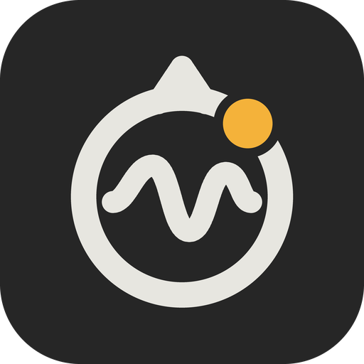
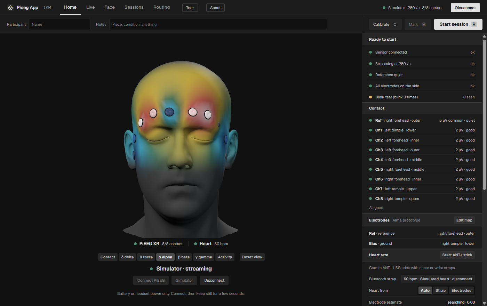
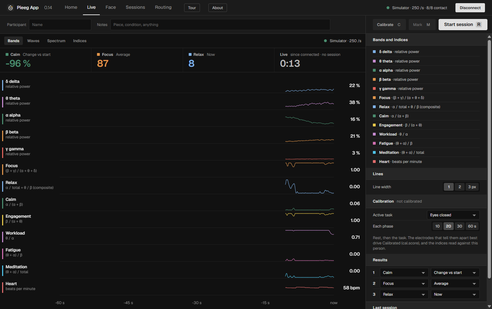
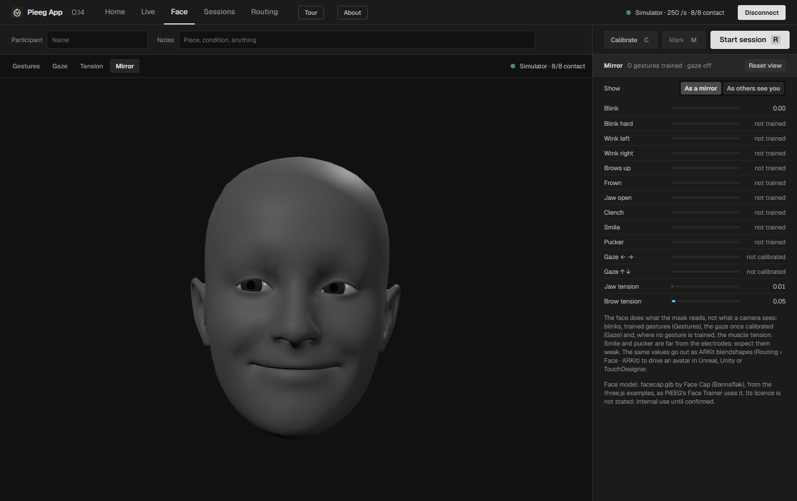

<p align="center"></p>

<h1 align="center">Pieeg App</h1>

<p align="center">
A desktop companion for the <b>PiEEG XR</b> face mask: receive, check, calibrate, see, record and send biosignals<br>
to TouchDesigner, Unreal, Unity, Max, VRChat or a browser. Made for immersive and interactive art.<br>
Developed by <a href="https://almadigitalstudio.com">Alma Digital Studio</a> · Windows · version 0.14 · MIT licence
</p>

> **Not a medical device.** Research, art and play only. The numbers it shows (indices, heart rate, tension) are not
> health measures. **Power the PiEEG box only from a battery** (a power bank, the headset's battery or a laptop running
> on battery): never from a wall charger or a computer plugged into the mains while someone wears it.



## Contents

- [What it does](#what-it-does)
- [Get it running](#get-it-running)
- [First session, step by step](#first-session-step-by-step)
- [The electrode map](#the-electrode-map)
- [Sending signals to other software](#sending-signals-to-other-software)
- [Shows and installations](#shows-and-installations)
- [Files and data](#files-and-data)
- [For developers](#for-developers)
- [Status and known limits](#status-and-known-limits)
- [Documentation](#documentation)
- [Credits and licence](#credits-and-licence)

## What it does

| Page | What is there |
|---|---|
| **Home** | Connect over Bluetooth (no drivers, no pairing). A 3D head with the electrodes where the mask has them, coloured by contact or by band. A checklist before recording. **Contact per electrode** (its own noise, not what all channels share) and a separate **reference check**. The editable **electrode map**. Heart rate from an ANT+ stick, a Bluetooth strap, or (experimental) the electrodes. **Visitor mode** for installations. Stream health, including samples lost on Bluetooth. |
| **Live** | Bands over time, filtered waves, spectrum and 0–1 indices (calm, focus, relax, engagement, workload, fatigue, meditation, alpha asymmetry, beta surge). Filters: notch, 1–40 Hz, spike rejection (Hampel), average reference. **Personal calibration** (rest vs a task) so the indices read against this person. Up to three live **results** (change vs start, average, now, best 10 s…). |
| **Face** | What the mask reads from the face: **gestures** trained by example (clench, jaw open, smile, brows up, frown, hard blink, winks, pucker), **gaze** left/right/up/down from the eye muscles (9-dot calibration), **jaw and brow tension**, and **Mirror**: a face that does all of it live. |
| **Sessions** | Every recording with its notes and markers, its signals over time, a second session laid over it, **play a session as if live**, **export BDF**. |
| **Routing** | Any signal to any address: **OSC**, **WebSocket** (each with a phone-friendly live viewer) or **MIDI**. **Rules** that fire events, a **cue sheet**, **markers coming in** from other software, and **compatibility with PiEEG's own tools** (their WebSocket for their Unity plugin, VRChat parameters). |

**Tour** (top bar) walks through every panel in about two minutes; with no mask connected it runs the built-in simulator
so each panel has something to show. **About** has the licences and the safety notes.



## Get it running

**Windows 10 or 11** with Bluetooth Low Energy.

- **Installer or portable exe** (from Alma Digital Studio): `Pieeg-App-Setup-<version>.exe` installs it;
  `Pieeg-App-<version>-portable.exe` runs without installing.
- **From source** (Node.js 20 or newer):

```bash
git clone https://github.com/beltranlihn/Alma_Pieeg_App.git
cd Alma_Pieeg_App
npm install
npm start                # the app
npm start -- --sim       # the app with the simulator running (no mask needed)
npm test                 # 67 tests (DSP, contact, map, detectors, router, WebSocket, BDF, rules…)
npm run dist             # Windows installer + portable exe in dist/
```

The simulator also works from the app: **Home › Simulator**. In it, `B` blinks, `J` clenches, `←`/`→` look aside,
`E` closes the eyes and `1`–`8` take an electrode off the skin.

## First session, step by step

1. **Power** the PiEEG box from a battery. Put the mask on.
2. **Home › Connect PiEEG.** *Stream* should read 250 /s. If it says *connected, but no data*, unplug the box for
   5 s and connect again (if it keeps happening, update its firmware: docs.pieeg.com › PiEEG XR › Service).
3. **Electrode map:** Home › Electrodes › *Edit map*. Pick the preset that matches your mask (see below) and Apply.
4. **Contact:** the *Ref* row should say *quiet* and each channel *good* or *fair*. If every channel looks alike and
   Ref says *noisy*, the reference or bias disc is not touching: press them, a drop of saline helps.
5. **Blink three times:** the checklist ticks the blink test.
6. **Calibrate** (`C`): rest, then a task (eyes closed, counting…), 10–60 s each. The indices then read 0–1 for this
   person.
7. **Face:** record each gesture twice in *Gestures* (it says *ready* from the second recording when it is reliable),
   run the 9 dots in *Gaze*, watch *Mirror*.
8. **Start session** (`R`), drop markers with `M`, **End session**. The files land in `Documents\Pieeg App\sessions`.



## The electrode map

The PiEEG XR pad has **ten discs, five per side, none on the nose**: three along each brow (inner, middle, outer)
and two down each temple. The board has ten inputs: **E1–E8**, **Ref** and **Bias**. Which input sits on which disc
depends on how the mask is wired, so the app keeps it as a map (Home › Electrodes › Edit map). Everything that
depends on position follows it: labels, the 3D head, blinks (forehead − temples), gaze (right − left temples), alpha
asymmetry, tension, regions.

| Wearer's side → | Temple low | Temple up | Brow outer | Brow middle | Brow inner | | Brow inner | Brow middle | Brow outer | Temple up | Temple low |
|---|---|---|---|---|---|---|---|---|---|---|---|
| **PiEEG XR documentation** | E1 | E2 | E3 | E4 | **Ref** | | **Bias** | E5 | E6 | E7 | E8 |
| **Alma prototype** (multimeter, 2026-11-17) | E1 | E7 | E3 | E4 | E2 | | E6 | E5 | **Ref** | E8 | **Bias** |

To check a mask: multimeter on continuity, one probe on the gold pad under each connector of the board (left to
right: E1 … E8, Bias, Ref), the other on each disc until it beeps. An input that beeps on no disc can be set to
*not connected*: it then stays out of every average, of the reference check and of the counts.

## Sending signals to other software

Add a **destination** and **mappings** (signal → address, input range → output range, smoothing, int/float, rate).

| Destination | What the receiver gets |
|---|---|
| **OSC · UDP** | One message per mapping: `/alma/calm 0.42`. Events (blinks, gestures) as ints. |
| **WebSocket** | The app listens on `ws://<computer>:<port>`; each tick one JSON frame: `{"t": 1763390000000, "values": {"/alma/calm": 0.42, "/alma/blink": 1}}`. Open `http://<computer>:<port>/` in a browser (a phone on the same network too) for a **live viewer**. |
| **MIDI** | A port of the computer (on Windows, a virtual one with loopMIDI). Address `cc 7` sends 0–127; `note 60` is on while the value is in the upper half. |

**Signals** (the full list is in the Routing page): indices `idx.*` (0–1 for this person), relative and absolute
bands, `cal.score`, alpha asymmetry, beta surge, per-channel amplitude/muscle/bands, **regions** (`region.lf.alpha`,
`region.rt.emg`…), gestures `face.*` (probability and on/off), gaze `gaze.x/y/side`, tension `tension.jaw/brow`,
the **face joystick** (`joy.x` gaze, `joy.y` brows up / jaw, `joy.press` hard blink), **ARKit blendshapes**
`arkit.*` (27 of the 52 standard face-rig coefficients, to move an avatar in Unreal/MetaHuman, Unity or VRChat), blink
pulse/count, heart (bpm, beat, HRV, source), contact, stream rate and loss, markers, rules, cues, visitor state,
**PiEEG-style** band values `pieeg.*`, session results.

**Ready-made receivers** in [`receivers/`](receivers/): TouchDesigner (OSC In CHOP, WebSocket DAT callbacks), Max
(patch), Unity (WebSocket receiver, marker sender), Unreal (OSC Blueprint steps), Python (OSC, PiEEG WebSocket, markers).

**PiEEG compatibility** (Routing): their WebSocket on port **1616** (one frame per sample
`{"t", "n", "channels": [8 µV]}`, their welcome message and their `start_record` / `stop_record` / `set_filter`
commands), so **PiEEG's Unity plugin** (`com.pieeg.unity`) connects to this app unchanged; and the **VRChat** avatar
parameters `/avatar/parameters/EEG_Delta … EEG_Gamma` to 127.0.0.1:9000.

## Shows and installations

- **Markers and commands in** (UDP, 127.0.0.1:9001 by default; choose *The network* to accept them from a headset):
  `/alma/mark "scene 2"` stamps a marker in the recording and sends `marker.pulse` out; `/alma/session/start "name"`,
  `/alma/session/stop`, `/alma/calibrate`, `/alma/cues/start`, `/alma/cues/stop` drive the app. Any plain-text UDP
  datagram, or `{"mark": "…"}` over a WebSocket port, is a marker too.
- **Rules:** "calm above 0.7 for 5 s → send /lights/fade", once per crossing, with a cooldown. To an OSC address, a
  WebSocket event, a MIDI note or an HTTP POST (webhook) with `{rule_id, rule_name, trigger_type, value, threshold, ts}`.
- **Cue sheet:** timed messages from the start of each session (or Run), each fired once and marked in the recording.
- **Visitor mode** (Home): notices the mask going on (contact for 3 s) and off (5 s without); each visitor starts fresh
  and settles for 30–60 s; meanwhile, and between visitors, continuous outputs ease to zero, the middle or their last
  value. Optional: one session per visitor. Bluetooth keeps reconnecting while it is on.
- **Play a session as if live** (Sessions): rehearse a patch, tune rules or show a piece without anyone wearing the mask.

## Files and data

Everything stays on the computer: nothing is sent online; signals leave only to the destinations set in Routing.

| What | Where |
|---|---|
| Recordings | `Documents\Pieeg App\sessions\<participant>_<YYYYMMDD_HHMMSS>.*` |
| `.raw.csv` | `timestamp, ch1…ch8, mark`: Unix seconds, raw µV (DC included), the same layout as PiEEG's own recordings |
| `.features.csv` | one row every 100 ms: bands, indices, blinks, gestures, gaze, tension, heart, contact, markers… |
| `.summary.json` | participant, notes, duration, per-signal mean/start/end/min/max, results, calibration, face models, marks |
| `.bdf` | on demand (Sessions › Export): BDF+, 24-bit like the converter, marks as annotations; opens in MNE (`mne.io.read_raw_bdf`), EEGLAB, EDFbrowser, PiEEG Studio |
| Settings | `%APPDATA%\Pieeg App\config.json`: routing, electrode map, face models, rules, cues, visitor mode, view options |
| Routing files | Routing › Export / Import (JSON), to carry a setup to another computer |

A recording holds the participant's name and notes as typed: ask people before recording them, and delete their files
when asked. The app was called *EEG Alma Center* until 0.14; on its first start the new version copies the old
settings and renames `Documents\EEG Alma Center` to `Documents\Pieeg App`.

## For developers

Plain Electron 44, no bundler: ES modules in the renderer, `contextIsolation` + sandbox, one preload bridge
(`window.alma`). Web Bluetooth with a device chooser in the main process. Design: the VEATION system
(`assets/tokens.css`, Geist).

| Where | What |
|---|---|
| `main.js`, `preload.js` | window, Bluetooth chooser, files, OSC sockets, WebSocket listeners, UDP input, self-test harness |
| `src/ble.js`, `src/sim.js`, `src/replay.js` | the sources: PiEEG XR over BLE (notify `fe42`, 24 bytes per sample, 24-bit → µV), the simulator, a saved session |
| `src/engine.js`, `src/dsp.js`, `src/ring.js` | the pipeline: source → filters → ring buffers → features at 20 Hz |
| `src/quality.js`, `src/montage.js` | contact per electrode and the reference check; the electrode map and its groups |
| `src/fft.js`, `src/indices.js`, `src/calibrate.js` | bands, PiEEG-style indices, per-person calibration (Cohen's d) |
| `src/detect.js`, `src/face.js`, `src/gaze.js`, `src/tension.js`, `src/arkit.js` | blinks, gestures (Face Trainer: group-lasso logistic), EOG gaze, muscle tension, ARKit mapping |
| `src/heart.js`, `src/heartest.js`, `ant.js` | Bluetooth and ANT+ heart rate; the experimental estimate from the electrodes |
| `src/signals.js`, `src/router.js`, `src/midi.js`, `osc-encode.js`, `ws-server.js` | the signal catalogue and the outputs |
| `src/inputs.js`, `src/rules.js`, `src/cues.js`, `src/visitor.js`, `src/compat.js` | markers in, rules, cue sheet, visitor mode, PiEEG compatibility |
| `src/record.js`, `src/session.js`, `src/bdf.js` | recording, session log and results, BDF export |
| `src/head.js`, `src/facemirror.js`, `src/scope.js`, `src/spectrum.js` | the 3D head, the Mirror face, the waves, the spectrum |
| `src/pages/*.js`, `src/tour.js`, `src/about.js` | the five pages, the guided tour, About |
| `tests/` | `node --test`: 67 tests |
| `tools/make-icon.py` | draws the app icon (ico, png, svg) |

**Self-test harness** (used for every change): `npx electron . --sim --page=<page> --view=<view> --size=1400x900
--quit-after=6000 --shot=out.png --probe=<url-encoded JS>` captures the window and prints what the probe returns.
Also `--tour=<step>`, `--face=<gesture,…>`, `--gaze`, `--tension`, `--calib=<s>`, `--wstest=<port>`, `--connect`.

## Status and known limits

- **Tested** with the simulator, the test suite and external OSC/WebSocket/Python clients. **With the real mask**:
  connection, contact, the reference check, blinks and recordings (first tests 2026-11-17). Gestures, gaze, Mirror and
  the show features still need a pass with the mask on.
- **Bluetooth** drops when the head or body is between the box and the computer; keep the box in line of sight. The
  board can stay "connected but silent" after a drop until it is unplugged.
- **Heart from the electrodes** is experimental: it says a number only when the rhythm is clear, and in the first real
  recordings it mostly did not. Record with a strap on too to compare (both are logged).
- **Smile and pucker** are far from the electrodes: expect them weak.
- **Not yet:** LSL output (needs the native liblsl), P300 and trained mental commands (forehead dry electrodes).
- The **Mirror face** (`assets/models/facecap.glb`, Face Cap by Bannaflak, from the three.js examples) has no stated
  licence: confirm it before any commercial or public release, or swap in another ARKit face.

## Documentation

- [`docs/QUICKSTART.md`](docs/QUICKSTART.md): the short guide for PiEEG XR users.
- [`docs/PLAN-FEATURES.md`](docs/PLAN-FEATURES.md): the feature plan and what is done.
- [`docs/CHANGELOG.md`](docs/CHANGELOG.md): what each version added.
- [`docs/ROADMAP.md`](docs/ROADMAP.md): history, first real tests, next steps.
- [`receivers/README.md`](receivers/README.md): receiving in TouchDesigner, Max, Unity, Unreal, Python.
- [`THIRD-PARTY-NOTICES.md`](THIRD-PARTY-NOTICES.md): what ships inside and under which licence.
- PiEEG XR: [docs.pieeg.com](https://docs.pieeg.com/hardware/devices/PiEEG_XR/).

## Credits and licence

**Pieeg App** is free software under the [MIT licence](LICENSE), © 2026 Alma Digital Studio.

Built on the open-source work of the **PiEEG Community** (PiEEG-server and pieeg.js, MIT): the BLE protocol, the
indices, and the shape of the gesture, gaze, calibration and artifact detectors are ported from it. Also inside:
Electron (MIT), three.js (MIT), the Lee Perry-Smith head scan (CC BY 3.0, Infinite-Realities), Geist (OFL 1.1) and
facecap.glb (licence not stated). Details in [`THIRD-PARTY-NOTICES.md`](THIRD-PARTY-NOTICES.md).

PiEEG and PiEEG XR are made by PiEEG. ANT+ is a trademark of Garmin Canada Inc. Their mention does not mean they
endorse this app.
